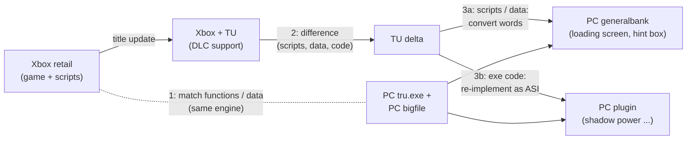

# trudlcport – personal Windows fork

-8A2BE2)

> [!WARNING]
> **This is a personal fork, not the original project.** For installing the DLC port, releases and reporting
> problems, use the original: **[andrearicci93/trudlcport](https://github.com/andrearicci93/trudlcport)**.

> [!NOTE]
> **Built with AI assistance.** The changes on branch `windows` (scripts, tools, documentation) were written with
> [Claude Code](https://claude.com/claude-code) (Anthropic's AI assistant), directed and checked by me, and tested on
> one Windows PC with my own copy of the game and my own Xbox 360 DLC files. They may contain mistakes.

**What this fork is**

- A copy of the original repository with its **full, unchanged history**; my work sits on top of it on branch
  `windows`. Every change is visible in the comparison
  [`main...windows`](../../compare/main...windows) and can be picked up from there.
- Made for my own use: running the upstream pipeline on Windows, learning how it works, rebuilding DLC 1 step by step
  and comparing it with the B138 release, then trying DLC 2 (*Lara's Shadow*) and the costume packs.
- **It does not replace the original** and is not a competing release. No support, no guarantees, no game data: like
  the original, everything needs your own files.

**Current state (2026-10-30, tested on one PC, not a release)**

- DLC 1 (B138): fixes found while testing - the "display driver" box on entering the DLC (shader constants), the
  grapple ring's look, cinematic speech in all five languages. Rebuilt reproducibly by the pipeline step `Repair`.
- DLC 2 (*Lara's Shadow*): converted with the original's pipeline plus new stage-2b fixes - intro at normal speed,
  no crash after it, the first level loads and runs, loading-screen titles and the title-update hint box like on the
  Xbox. Open: shaders (waterfall, walls).
- Both DLC: our `generalbank` (the title update's loading-screen and hint-box scripts ported to PC) is built by the
  pipeline step `Generalbank`.

> [!IMPORTANT]
> **DLC 2 cannot be finished on PC yet - the PC game lacks the Doppelgänger / shadow power.** On the Xbox, *Lara's
> Shadow* lets Lara use the Doppelgänger's power (hold LB/RB: world slows to 0.3, Lara moves at 1.2, a shadow meter
> drains; attach to and climb "rock veins"; shadow combat moves). That mechanic is **program code of the Xbox title
> update** (its exe patch), not data - the PC `tru.exe` never received it, so no data conversion can bring it back.
> The first rock vein comes right after the start, and several puzzles require the slow motion. Measured: the title
> update adds ~390 functions (<= ~157 KB PowerPC code); the slow motion itself turned out to use an engine time-scale
> system the PC exe already has (`SetWorldTimeScale` / `SetPlayerTimeScale`): calling them on LB/RB with the Xbox's
> values already works in a debugger prototype (camera and water slow down, Lara keeps her speed), an ASI is in
> progress; the meter, rock veins and the combat moves still need a re-implementation. Details:
> [docs/DLC2.md](docs/DLC2.md#doppelgänger--shadow-power-missing-on-pc) and WINDOWS_REBUILD.md finding 43.
- What was found and why, for anyone (including the original author) who wants to pick it up:
  [docs/WINDOWS_REBUILD.md](docs/WINDOWS_REBUILD.md) finding 43, [docs/DLC2.md](docs/DLC2.md).

**How the Xbox title update is brought to PC (approach)**

The PC game is close to the Xbox retail game; the DLC need the Xbox **title update** on top. So the missing PC piece
is the title update's *difference*, translated: PC + (TU - Xbox retail) = what the PC needs.

| Step | What | State (2026-10-30) |
|---|---|---|
| 1 | Match Xbox retail and PC: functions, natives, globals (`tools/xbox_pc_funcmap.py`) | first pass: 4 155 pairs, ~1 000 confirmed |
| 2 | Difference Xbox retail -> Xbox + TU (`tools/xbox_func_diff.py`, Xenia memory images) | done: 391 new, 937 changed functions; scripts / sections listed |
| 3a | Scripts and data of the TU on PC (converted, repaired where PC differs) | loading screen with DLC titles and the hint box done (pipeline step `Generalbank`) |
| 3b | Exe code of the TU on PC (shadow power) | slow motion proven with the PC's own engine functions; ASI in progress; meter, rock veins, combat open |

**What is new here** (details on branch `windows`)

- [scripts/windows/](scripts/windows/README.md) – PowerShell scripts: install the kit, swap single mod files, display
  mode and language, tools, the pipeline step by step, a pre-upload check
- [docs/WINDOWS_REBUILD.md](docs/WINDOWS_REBUILD.md) – running the pipeline on Windows: missing glue scripts rebuilt,
  stage-by-stage comparison with B138, run log and findings
- [docs/ARCHITECTURE.md](docs/ARCHITECTURE.md) – overview of the Windows rebuild: data flow, steps, learned tables,
  how results are verified
- [docs/RELATED_WORK.md](docs/RELATED_WORK.md) – what we researched and found: earlier attempts to bring the TRU DLC
  to PC (Tomb Raider Forums 2011-2026), cdcEngine tools, other porting/decomp/recomp projects, techniques worth
  adopting
- [docs/WS_MAP.md](docs/WS_MAP.md) – map of the author's `work/ws/` scripts, builds and overlay layers
- [docs/DLC_MENU.md](docs/DLC_MENU.md), [docs/DLC2.md](docs/DLC2.md), [docs/COSTUMES.md](docs/COSTUMES.md) – DLC menu
  text fix (all six languages), notes on DLC 2 and the costume packs
- New tools in `tools/` (e.g. `compare_b138.py`, `compare_sections.py`, `compare_audio.py`, `dlc_media_build.py`,
  `dlc_audio_build.py`, `mul_audio_nch.py` - the audio fix for non-stereo `.mul`, `dlc_assemble_build.py` (also DLC 2),
  `mesh_tables_build.py`, `tree_check.py`)
- [CHANGELOG.md](CHANGELOG.md) – section "Fork branch `windows`" at the top: what this fork changed, by date (no
  release of the port)

Versions of this fork are named `<date>[.<n>]-B<upstream build>`, e.g. `20261027-B138`: the B number is always the
original's build it is based on.

All credit for the port itself goes to **andrearicci93**. License: MIT, as the original ([LICENSE](LICENSE)).

---

*The original README follows unchanged.*

# trudlcport

Port of the **Xbox 360-only DLC of Tomb Raider: Underworld** (*Beneath the Ashes*) to the **Steam PC game**, without an emulator.
**DLC1 is playable from the start to the end credits.** DLC2 (*Lara's Shadow*) is not converted yet.

Latest build: **B138** → [Releases](https://github.com/andrearicci93/trudlcport/releases/latest)

## Install

You need: the Steam PC game, your own Xbox 360 DLC files (`pack10.000`, `credits_DLC1.wmv`), [ModLoader](https://github.com/TombRaiderModding/ModLoader/releases) in the game folder, and Python 3.9+ with `pip install bsdiff4`.

1. From [Releases](https://github.com/andrearicci93/trudlcport/releases/latest) download `install_dlc.py` and `trudlcport-kit-B138.zip`; unzip the kit into a folder named `kit`.
2. Close the game and check your files first:
   `python install_dlc.py --game "<game folder>" --dlc "<folder with the Xbox files>" --kit kit --check`
3. If it says *All inputs OK*, run the same command without `--check`. The old `mods\` and `tru.exe` are kept as backups.
4. Start a **new DLC game** from Steam → *Downloadable content* → *Beneath the Ashes*, and **lock the game to 60 fps**.

Details, requirements and problems (display-driver error, crashes, 60 fps): [docs/INSTALL.md](docs/INSTALL.md) · [docs/TROUBLESHOOTING.md](docs/TROUBLESHOOTING.md)

## Changelog

**B138 (21 Oct 2026) — offline-verified, not played yet** (B132 is the last build played end to end)
- B133: 274 shaders fixed for native Direct3D 9 (probable cause of the *"display driver"* error on real GPUs)
- B134–B137: mechanism joints in pillory and dungeon, bat generators
- B138: DLC audio no longer crackles (39 `.mul` re-encoded)

Still open: rare crash at start-up (restart), golden shotgun untested, dungeon material 23211, DLC2.
Full list, with what should now be fixed and what to report: [CHANGELOG.md](CHANGELOG.md).

## More

[Status](docs/STATUS.md) · [Development notes, repository map, rebuild](docs/DEVELOPMENT.md) · [Technical findings](docs/FINDINGS.md)

## Legal

Tomb Raider: Underworld and its DLC belong to their respective owners. This project is unofficial and for people who own the PC game and the Xbox 360 DLC: the release kit is binary patches that are useless without (and checked against) your own files, and the repository contains no game data. Code is MIT-licensed (see `LICENSE`).
