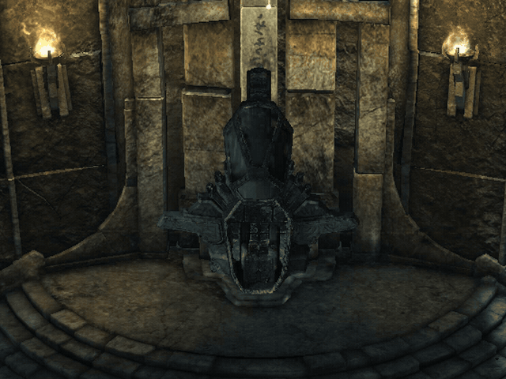
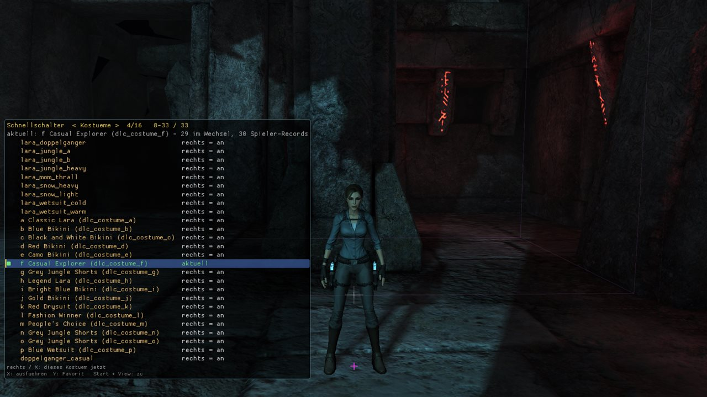
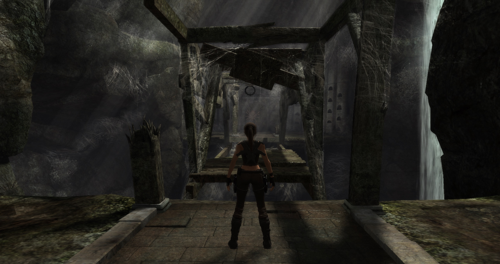
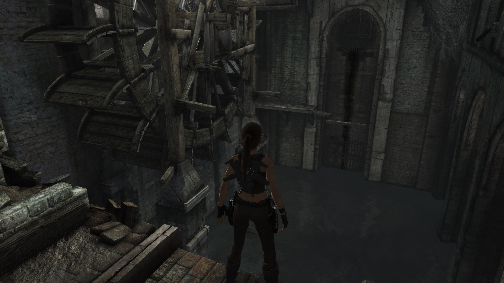
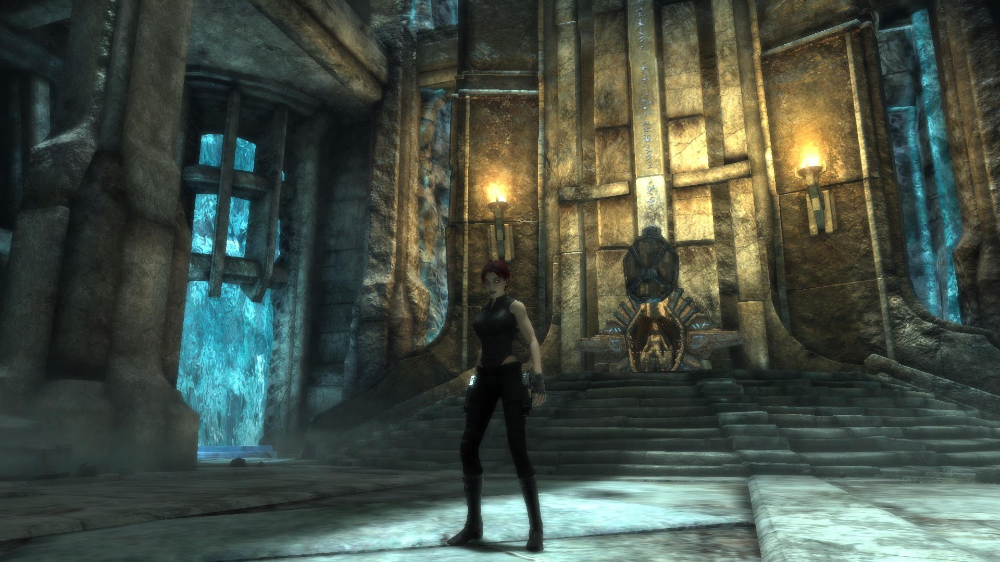

# Tomb Raider: Underworld – DLC for PC

**Play the two Xbox 360-only chapters of *Tomb Raider: Underworld* - *Beneath the Ashes* and *Lara's Shadow* - on
the PC version of the game.**

This is my personal, unofficial fork of [andrearicci93/trudlcport](https://github.com/andrearicci93/trudlcport), the
project that first converted the DLC for the PC. You need your own copy of the game and your own Xbox DLC files.

-8A2BE2)

*Work in progress (8 Nov 2026): the end-room cutscene of Lara's Shadow on PC, held with TruMenu's cutscene pause. The
scene stands still, yet the throne keeps flickering - the shadows of three cutscene lights, traced live into the
engine's shadow atlas ([DEVLOG](docs/DEVLOG.md), [ENGINE.md](docs/ENGINE.md) section 16).*

> [!WARNING]
> **This is a personal fork, not the original project.** For installing the DLC port, releases and reporting
> problems, use the original: **[andrearicci93/trudlcport](https://github.com/andrearicci93/trudlcport)**.

> [!NOTE]
> **Built with AI assistance.** The changes on branch `windows` (scripts, tools, documentation) were written with
> [Claude Code](https://claude.com/claude-code) (Anthropic's AI assistant), directed and checked by me, and tested on
> one Windows PC with my own copy of the game and my own Xbox 360 DLC files. They may contain mistakes.

The original's full history is kept; my work sits on branch `windows` ([`main...windows`](../../compare/main...windows)).
It does not replace the original. More about the fork: [docs/README.md](docs/README.md#about-this-fork).

**What this fork does**

1. **The DLC port for PC.** DLC 1 *Beneath the Ashes* and DLC 2 *Lara's Shadow*, converted from the Xbox files by the
   upstream pipeline run on Windows. For DLC 2 the fork makes its own conversion; data faults found in game become
   pipeline steps.
2. **The Xbox title update's program code as plugins.** The shadow power of *Lara's Shadow* came with an Xbox game
   update, not with the DLC files. Its functions are translated one by one into ASI plugins (shadow power, combat,
   HUD, rock veins, the doppelganger as player).
3. **Fixes and comfort for the base PC game.** `TruQoL` (60 fps cap, field of view, camera shake, a start-up fix for
   PCs with many CPU threads), the test menu `TruMenu`, `Set-TruDisplay.ps1` and a table of known problems.

**State on 2026-11-08** (one PC, not a release; "played" = tested in game, "offline" = only static checks)

| Part | What works | State | What is missing |
|---|---|---|---|
| DLC 1 *Beneath the Ashes* | the "display driver" box on entering, the grapple ring's look and cinematic speech in five languages fixed (pipeline step `Repair`); starts correctly after DLC 2 in the same session | played | a crash while loading the dungeon in our test builds: cause found (a DLC 2 effect file of the same name kept a raw texture group count), fix built offline, live test open |
| DLC 2 *Lara's Shadow* | through the Yggdrasil halls: intro, loading-screen titles and hint boxes, the doppelganger's look, shadow power, wall run, combat, waterfall; 8 Nov: end cutscene visible, no crash in the ceremony room, end-room floor and goo drips right | played; the end area only reached by a level change | **manual play stops at the jump from a ledge to a rock vein**: Lara reaches the vein's attach state, then turns back to the ledge within 0.2-0.6 s (analysis pending); further only with TruMenu's teleports. Also: the shadow finisher never starts, a moaning sound loops, flicker in the end cutscene, some title-update shaders still drawn with substitutes, the achievement fix untested |
| Xbox title update plugins | slow motion, meter and HUD, power states, wall run and its camera, shadow combat input; thralls take damage and die (title-update damage switch, 7 Nov) | partial: these parts played, the newest versions offline | the finisher's own kill; Lara's ponytail stretches in slow motion (the cloth time step is translated behind a switch, off) |
| Base-game fixes | `TruQoL` frame limiter at 60 fps; thread cap 8 / 16 / 24 on a 36-thread PC; `TruMenu` with the pages "Fixes" and "Rettung"; known problems in TROUBLESHOOTING | partial: frame limiter and thread cap played, FOV, shake, intro skip and `Set-TruDisplay` graphics options offline | thread cap above 24 hangs (default to become 8); Steam overlay with TruMenu can crash |

Costume packs: converted and checked offline (pipeline step `Costumes`), not played yet. Per plugin:
[docs/PLUGINS.md](docs/PLUGINS.md).

*Development build (7 Nov 2026): the start of Lara's Shadow with the test menu's quick bar, page "Kostueme"
(TruMenu 0.21.6), here the DLC costume f "Casual Explorer". Older snapshots and states: [docs/DEVLOG.md](docs/DEVLOG.md).*

**Where to read on**

- [docs/README.md](docs/README.md) – index of all documents, by reader
- [docs/PLUGINS.md](docs/PLUGINS.md) – every plugin: purpose, version, state, INI switches; how the title update is
  brought to PC
- [docs/INSTALL.md](docs/INSTALL.md) and [docs/TROUBLESHOOTING.md](docs/TROUBLESHOOTING.md) – install, known problems
- [CHANGELOG.md](CHANGELOG.md) – section "Fork branch `windows`": every change by date
- [docs/ENGINE.md](docs/ENGINE.md) – how the engine works, with addresses and proofs
- [docs/DLC2.md](docs/DLC2.md) – DLC 2 notes and the shadow power analysis

Versions of this fork are named `<date>[.<n>]-B<upstream build>`, e.g. `20261027-B138`: the B number is always the
original's build it is based on.

All credit for the port itself goes to **andrearicci93**. License: MIT, as the original ([LICENSE](LICENSE)).

---

*The original README follows unchanged, as of B270 (upstream `main` 7761890); releases and the installer are in the
[original repository](https://github.com/andrearicci93/trudlcport).*

# trudlcport

This project ports the **Xbox 360-only DLC of Tomb Raider: Underworld** to the **Steam PC game**, with no emulator:

- **Beneath the Ashes** (DLC1) can be played from the start to the end credits.
- **Lara's Shadow** (DLC2) can be played as the doppelganger through its levels. Its ending is fixed offline but has not yet been confirmed in game.

Latest build: **B270** (release build `B270_acqua`) → [Releases](https://github.com/andrearicci93/trudlcport/releases/latest)

B270_acqua is B269_nativo (B269_tubi plus native-D3D9 shader fixes) plus a fix for black water in the DLC1 dungeons. B269_tubi was tested in the VM; B269_nativo is in its first VM test; B270_acqua was installed in the VM: the black water of the DLC1 dungeons is fixed (it now looks translucent, like on Xbox).

## Screenshots

On the Steam PC game, no emulator:

| Beneath the Ashes (DLC1) | Beneath the Ashes (DLC1) | Lara's Shadow (DLC2) |
|---|---|---|
|  |  |  |
| The cobwebbed bridge, build B269_nativo | The water wheel hall, build B269_nativo | The doppelganger in the ceremony room, build B269 |

## What you need

- **Tomb Raider: Underworld**, the Steam PC version (exe v1.1).
- **Your own Xbox 360 DLC files**: `pack10.000` (Beneath the Ashes) and `pack11.000` (Lara's Shadow). For the end credits you also need `credits_DLC1.wmv` and `credits_DLC2.wmv`.
- [Steamless](https://github.com/atom0s/Steamless/releases), run once on your own `tru.exe`. The patched exe is built from its output.
- [ModLoader](https://github.com/TombRaiderModding/ModLoader/releases) in the game folder.
- **Python 3.9+**, then `python -m pip install bsdiff4 numpy`.
- For the end credits only, on Windows: [ffmpeg](https://www.gyan.dev/ffmpeg/builds/) and [RAD Video Tools](https://www.radgametools.com/bnkdown.htm). **Without the credits movie, the game stays on a black screen after the final cutscene of each DLC.**

## Install

> **Temporary test kit.** The B270 kit attached to the release is a test build for a few testers. It still carries about 37% of the installed bytes literally inside the patches (see Legal). The final release will not: the installer will recreate every file from your own game data.

1. From [Releases](https://github.com/andrearicci93/trudlcport/releases/latest) download `install_dlc.py`, `tex_convert.py`, `credits_convert.py` and `trudlcport-kit-B270.zip`. Put them in one folder and unzip the kit there into a folder named `kit`.
2. Run Steamless on `<game folder>\tru.exe`. It writes `tru.exe.unpacked.exe` next to it; leave that file there.
3. Close the game and check your files first. This step writes nothing:
   `python install_dlc.py --game "<game folder>" --dlc "<folder with the Xbox files>" --kit kit --check`
4. If it says **All inputs OK**, run the same command without `--check`. Add the credits options if you want them:
   `--credits --rad "<...\radvideo64.exe>" --ffmpeg "<...\ffmpeg.exe>"`
   This takes 5-20 minutes per DLC.
5. Lock the game to **60 fps**. In Steam, go to *Downloadable content* and start a **new** DLC game.

What the installer does:

- **Checks everything.** It verifies every source file and every installed file against MD5s.
- **Uses all your CPU cores.** Files are rebuilt in parallel (up to 8 processes; about 1.5 minutes for the 484 files on a 10-core PC instead of ~8). If the PC runs out of RAM, lower it with `--jobs 2` (`--jobs 1` = sequential).
- **Keeps backups.** Your previous `mods\` folder and `tru.exe` are kept.
- **Writes an install record.** `trudlcport_install.json` lists what was installed:
  - `python install_dlc.py --game "<game folder>" --verify` re-checks the installed files.
  - `python install_dlc.py --game "<game folder>" --restore` undoes the install. It deletes nothing: removed files are renamed with a date suffix.

Full guide: [docs/INSTALL.md](docs/INSTALL.md).

## Requirements and settings

- **Lock the game to 60 fps.** Physics and camera are tied to the frame rate. Above 60 fps, boxes, ragdolls and physics puzzles break. Any of these works:
  - in-game V-Sync on a 60 Hz display, or `EnableVSync=1` in the registry;
  - the NVIDIA *Max Frame Rate* or AMD *Frame Rate Target Control* limiter;
  - RTSS;
  - [dxwrapper](https://github.com/elishacloud/dxwrapper) with `LimitPerFrameFPS = 60`.
- **Windows' own Direct3D 9** should accept every shader of B270. Builds B147-B268 contained up to 240 pixel shaders (counted on B269_tubi) with forms that a real AMD driver rejected, which showed up as *"A problem has occurred with your display driver"*. Since B269 the expected count is 0. This is checked offline only; the native test still has to confirm it on a real GPU.
- **[DXVK](https://github.com/doitsujin/dxvk/releases)** is the fallback if a GPU still refuses something: copy `x32\d3d9.dll` next to `tru.exe`. dgVoodoo2 also works.

## Troubleshooting

| Symptom | What to do |
|---|---|
| `tru.exe: need the Steamless-unpacked v1.1 exe` | run Steamless on the Steam `tru.exe` (MD5 `b36da327…`) and try again |
| `source ... has a different MD5` | your game or DLC file is a different version or is damaged. Use "Verify integrity" in Steam |
| Black screen after a final cutscene | `movies\credits_DLC1.bik` / `credits_DLC2.bik` is missing: run the installer again with `--credits` |
| Crash right at start-up, now and then | the FMOD audio init fails and the game ignores the error. Start the game again |
| "A problem has occurred with your display driver" | run the native test (`trudlcport-native-test-v3.zip` in the release) and send `trudlcport_native_result.zip`. Meanwhile use DXVK |
| Boxes, ragdolls or camera behave strangely | lock the game to 60 fps |
| The DLC is missing from the menu | ModLoader is not installed |

More: [docs/TROUBLESHOOTING.md](docs/TROUBLESHOOTING.md).

## Status (B270)

"Played" means the project owner ran it in game (Windows 11 VM, dgVoodoo2). "Offline" means it was only checked with static gates and comparisons against the Xbox/PC originals.

| | |
|---|---|
| DLC1 *Beneath the Ashes* | Played end to end on B132. Later builds carry back to DLC1 the data fixes found for DLC2, all verified offline. The VM tests of B139-B269 focused on DLC2, so a full replay of DLC1 on B270 is still to do. |
| DLC2 *Lara's Shadow* | Played on B231-B269, up to the final area:  • the doppelganger's costume, colours, hair and attacks (Q/E, Shift+E, finisher)  • thralls, goo cannons, pools, bridges, columns  • the ceremony-room cutscene  • flying with F2 without crashes |

Known open issues:

- **Cutscene flicker on Natla.** Block-shaped patches appear on Natla, the doppelganger and the throne in the Natla cutscene. Cause not found.
- **Wall-run on the rock veins.** It does not grab in some places: on B269 one vein in front of the doppelganger reported `NONE`. It still has to be checked spot by spot.
- **Goo FX in the ceremony room switched off.** The four `dlc_fx_goo_ceremony*` effects rendered wrong shapes, so their emitters are at 0. The goo itself is fine.
- **Black water in the DLC1 dungeons (material 20262).** Fixed offline in B270, not yet seen in game. The surrogate vertex shader 976 did not write COLOR0, which the water pixel shader uses for its alpha. A newer driver reads that as 0, so the water turned invisible over a dark floor. The water now uses the base-game VS 164, the same shader plus vertex colour. Material 26584 in the DLC2 treasure room is fixed the same way (VS 243).
- **Guillotine (`dlc1_uo_guillotine`).** Not fixed. Its pixel shaders 738/739 discard on `v0.w`, which vertex shader 211 never writes.
- **Machine room.** The terrain (material 26622) is black: the fix is ready but needs a vertex shader too. The dark pipes (materials 22915/25901) are fixed offline in B269 and not yet confirmed.
- **Goo grinder / goo converter material 25165.** Black surrogate shader, not fixed.
- **Final sequence of DLC2.** The 045 → 050 → credits chain is fixed offline in B266, not yet confirmed. Credits need `credits_DLC2.bik`.
- **Older open items.** Rare FMOD crash at start-up, golden shotgun untested, dungeon material 23211.

Per-area detail: [docs/STATUS.md](docs/STATUS.md). Changes since B138: [CHANGELOG.md](CHANGELOG.md).

## Credits

- The Tomb Raider modding community, for [ModLoader](https://github.com/TombRaiderModding/ModLoader) and the TR8/cdcEngine format work.
- Xenia, for the Xenos texture and shader documentation.
- [Steamless](https://github.com/atom0s/Steamless), [DXVK](https://github.com/doitsujin/dxvk), [dgVoodoo2](http://dege.fw.hu/), [ffmpeg](https://ffmpeg.org/) and RAD Video Tools, which are used but not redistributed.
- The players who tested on real GPUs and sent native-test reports.

## Legal

Tomb Raider: Underworld and its DLC belong to their respective owners. This is an unofficial fan project for people who own both the PC game and the Xbox 360 DLC.

- **No game data in the repository.** It contains only code, documentation and tables of checksums.
- **The release kit is a set of binary patches** that the installer applies to your own files, after checking their MD5s.
  - Xbox textures are converted on your PC by `tex_convert.py`, not shipped.
  - The exe patch is computed against the Steamless output of your own `tru.exe`, so the kit does not carry the game's code.
  - What the installer cannot yet recreate on your PC is still **literal inside the patches**. Measured on the B269/B270 builds with `tools/release/patch_audit.py`, as a share of the installed bytes (decompressed):
    - about 37% overall;
    - about 29% of the DRM bytes: animation, mesh, audio and shader sections;
    - about 99% of the re-encoded `.mul` audio;
    - about 42% of the menu images;
    - 0.2% of the exe, which is code written for the port.
    Previous kits (B132/B138) were about 97% literal and included the credits movie.
- **The credits movies (`.bik`) are never distributed.** You make them on your PC from your own `.wmv` files with `credits_convert.py`.
- Code is MIT-licensed (see `LICENSE`).
