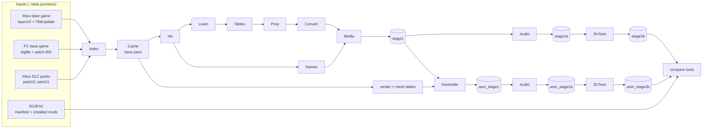

# Architecture of the Windows rebuild (branch `windows`)

Branch `windows` runs upstream's Python conversion pipeline (docs/PIPELINE.md, stages 0-1) on a Windows PC from the
user's own game files, adds the glue scripts upstream never published, and compares every intermediate tree with
upstream's released build **B138** - per file (MD5) and per DRM section type. Upstream's tools are called, not
copied; new tools are marked as such in their docstrings. The detailed log with all measurements is
[WINDOWS_REBUILD.md](WINDOWS_REBUILD.md) (findings are cited below as "F<n>").

## 1. Data flow



The trees live in `work/rebuild/<tree>/mods` (B138 layout: root, `streamgroups/`, `cinstream/`, `music/`, `audio/`,
`image/`, `local/`, `padshock/`, `tr8/`). The 2b fixes are pipeline step `Fixes` (section 4).

## 2. Pipeline steps

`scripts/windows/Invoke-TruPipeline.ps1 -Step <name>` runs the tools of one step in order, from the repository root,
with `../bin/venv/Scripts/python.exe -u -I -X utf8`. Order: Index, Cache, Ids, Learn, Tables, Prep, Convert, Names,
Media, Audio, then optionally Assemble. Durations are from the run log of WINDOWS_REBUILD.md unless a finding is cited.

| Step | Tools (in order) | Main inputs | Outputs | Duration / memory |
|---|---|---|---|---|
| Index | `index_all.py` x3 (PC `le`, Xbox base `be`, DLC `be`; parts `@7ff00000`) | PC bigfile + patch.000, Xbox layer1/2 + TitleUpdate, pack10/11 | `work/idx_pc.json`, `idx_xbox_base.json`, `idx_dlc.json` | 45 s |
| Cache | `generic_cache.py`, `generic_cache.py patch` | archives, Yura name lists (`ref/`) | `work/generic/pairs.pkl`, `pairs_patch.pkl` (1054 base pairs, F12) | 26-27 s (F12) |
| Ids | `generic_store.py`, `generic_ids.py`, `objlists_extract.py` (new), `objlist_merge.py` | pair caches, `idx_pc.json` | `store.pkl`, `idmap.json`, `lists/`, `merged/` | 43 s |
| Learn | `generic_learn.py save`, `generic_symbols.py seed`, `script_pairs.py`, `unit_ids.py` | pair caches, `idmap.json` | `mask_table.pkl`, symbols in `idmap.json`, `work/script/pairs_*.pkl`, `unit_idmaps.json` | about 26 min |
| Tables | `dlc_drms_build.py` (new), `dlc_generic.py` (provisional), `script_learn.py save`, `generic_type0.py save07`, `script_name_match.py`, `tex_idmap.py`, `dlc_generic.py` (final) | DLC packs, base tables | `dlc_drms.pkl`, `dlc_idmap.json`, `work/script/script_table.pkl`, refined `idmap.json` | 824 s; 6 977 s under memory pressure (F29) |
| Prep | `generic_type0.py save07`, `pc_vers_build.py` (new), `model_point_fix.py learn`, `model_point_fix.py selftest`, `dtpid_evidence.py` | final `idmap.json`, pair caches, `idx_pc.json` | `type0_table.pkl`, `type7_table.pkl`, `pc_vers*.json`, `work/chain_aim/model_point_rules.pkl`, `dtpid_evidence.pkl` | 818-1 755 s |
| Convert | `dlc_convert_all.py --media --write --extra-fixes` | `dlc_drms.pkl`, all learned tables | `work/generic/out/pack10|pack11/*.drm` (300 files) | 42-80 min single process, 18.2 GB; `--jobs 2` 2 824 s (F36) |
| Names | `dlc_names.py` (any time after Ids) | packs, Yura lists, `docs/data/*.kit_manifest.json` | `work/generic/dlc_names.txt` | 160 s |
| Media | `dlc_media_build.py` (new), `locals.py build`, `padshock_convert.py build`, `compare_b138.py`, `compare_sections.py` | `out/pack10`, names, merged lists, Xbox media | `work/rebuild/stage1/mods` + reports | 31-64 s, ~1.4 GB (F36) |
| Audio | `dlc_audio_build.py` (new), `compare_b138.py`, `compare_sections.py` | stage1, Xbox audio, ffmpeg | `work/rebuild/stage2a/mods` (replaced every run) | 93-117 s, < 20 MB per process (F36) |
| Assemble | `render_tables_build.py build`, `rend_extract.py pairs`, `render_tables_build.py check`, `rend_extract.py dlc`, `shader_map.py`, `material_rules.py`, `material_dlc.py`, `pc_shader_sections.py`, `terrain_validate.py`, `mesh_tables_build.py` (new), `dlc_assemble_build.py` (new), `dlc_audio_build.py`, `compare_b138.py`, `compare_sections.py` | stage1, pair caches, `idmap.json`, `idx_dlc.json` | `work/render/*`, `asm_stage1/mods`, `asm_stage2a/mods` | 2 934-3 036 s; `dlc_assemble_build` 15.6 GB, `--jobs 2` 1 439 s (F36) |

Why the order: `generic_store` needs `idx_pc.json` (F1); `unit_ids` needs `work/script/pairs_8.pkl` (F4);
`script_learn` needs a `dlc_idmap.json`, which is rebuilt at the end of Tables after `script_name_match` and
`tex_idmap` have rewritten the base map (F5); Convert with extra fixes needs the model point rules and the dtpid
evidence (F32). The two runs of `generic_type0.py save07` (Tables and Prep) are as configured; the second one trains
on the final id map.

## 3. Learned tables

Almost everything the converter knows comes from **paired base-game data**: the same file name exists as an Xbox
DRM (layers + TitleUpdate) and as a PC DRM (bigfile + patch.000; the runtime version wins on both sides). Paired
sections give id maps and word-conversion rules, which are then applied to the Xbox-only DLC. All files are below
`work/generic/` unless shown otherwise, and all are ignored by git (derived from game data).

| Table | Content | Written by (step) | Read by |
|---|---|---|---|
| `pairs.pkl`, `pairs_patch.pkl` | decoded Xbox/PC DRM pairs (1054 + 4 patch pairs, F12) | `generic_cache` (Cache) | `generic_*`, `script_pairs`, `pc_vers_build`, `dtpid_evidence`, `render_tables_build` |
| `store.pkl` | PC ids per type, PC/Xbox section contents and normalised hashes | `generic_store` (Ids) | `dlc_generic` (routes `pc_copy`, `template`) |
| `idmap.json` | per section type `{xbox id: pc id}`; key `100` = Script Symbols (u16) | `generic_ids` (Ids); key 100 `generic_symbols seed` (Learn); `script_name_match` adds script ids + symbols, `tex_idmap` rewrites key 5 (Tables; backups `idmap_pre_snm.json`, `idmap_pre_tex.json`) | `dlc_generic.DlcIds`, `render_tables_build`, render tools |
| `merged/` | merged PC object/unit lists (= B138 by MD5, F11) + `object_id_remap_xbox_to_pc.json` | `objlist_merge` (Ids) | `DlcIds` (type 11), `dlc_media_build` (`tr8/`) |
| `unit_idmaps.json` | global unit-level spaces: unit, portal, terrain group, intro | `unit_ids` (Learn) | `DlcIds` via `generic_type0.space_maps` (pseudo types 110-112) |
| `mask_table.pkl` | word class per structural key (types 0, 7, 8, 13): s32, s16, raw, id fields ... | `generic_learn save` (Learn) | `dlc_generic` route `convert`, `generic_symbols` harvest |
| `work/script/pairs_*.pkl`, `script_table.pkl` | matched script/DTP pairs; Script word permutations per walker label | `script_pairs` (Learn), `script_learn save` (Tables) | `unit_ids`, `script_learn`; `dlc_generic` |
| `type0_table.pkl`, `type7_table.pkl` | type 0 / DTP classes incl. unit id spaces | `generic_type0 save07` (Tables, Prep) | `dlc_generic` |
| `dlc_drms.pkl` | every DRM of pack10 + pack11, decoded (not learned; ~3 GB) | `dlc_drms_build` (Tables) | `dlc_generic`, `dlc_convert_all` |
| `dlc_idmap.json` | ids of DLC-new sections + `sym_info` (Xbox max, PC max, shift) | `dlc_generic` (Tables) | `DlcIds` in every converter |
| `pc_vers.json`, `pc_vers_content.json` | PC section `ver` per id / per content (needed for MD5 equality, F7) | `pc_vers_build` (Prep) | `dlc_generic.convert_drm` |
| `work/chain_aim/model_point_rules.pkl` | byte permutations of model 'point' arrays (38 rules from 1055 model pairs, F32) | `model_point_fix learn` (Prep) | extra fixes of `convert_drm` |
| `dtpid_evidence.pkl` | which DTP words holding DTP ids are remapped (96.86 % rule precision, F32) | `dtpid_evidence` (Prep) | `dtpid_sweep` (extra fixes) |

**Symbols and calibration.** `DlcIds.sym()` maps an Xbox Symbol through the learned map; DLC-new symbols above the
Xbox maximum are shifted, unmapped base-range symbols are guessed from a neighbour (F27, F33). Two values are
measured on B138 and are therefore calibration, not base-pair learning: `DLC_SYM_SHIFT = 480` in `dlc_generic.py`
(the rule gives 481, F29) and the 167 Symbol values in `docs/data/b138_symbol_calibration.json`, used for exact
lookups only (`TRUDLC_SYM_EXTRA` = another file or `off`, F35). `generic_symbols.py seed` applies its range guard to
its own result since F27 (one bogus entry 0xBEEB had set the shift to 0).

**Render tables** (`work/render/`, step Assemble; dependency table in F28):

| Table | Written by | Read by |
|---|---|---|
| `pairnames.json`, `material_x2p.pkl`, `shader_x2p.pkl` | `render_tables_build.py build` (reconstructions: names of the 1054 pairs, idmap types 10 / 9; checked by `check`, F28) | `rend_extract`, `material_rules`, `material_dlc`, `material_reslot`, `shader_map`, `terrain_validate` |
| `pairs_render.pkl`, `dlc_render.pkl` | `rend_extract.py pairs` / `dlc` | render tools, `mesh_tables_build` |
| `dlc_shader_map.json`, `dlc_material_shaders.json` | `shader_map.py` | `material_dlc`, `material_reslot`, `pc_shader_sections` |
| `param_rules.pkl` | `material_rules.py` | `material_dlc` |
| `dlc_materials_pc.pkl` | `material_dlc.py` | `material_reslot`, `pc_shader_sections`, `material_dlc`'s lookup in the assemble route (material 'dlc') |
| `pc_shader_sections.pkl` | `pc_shader_sections.py` | `assemble_dlc` |
| `terrain_yhash.pkl` | `terrain_validate.py` | `terrain_convert` |
| `pc_vdecl_hash.pkl`, `dec3n_lut.pkl` | `mesh_tables_build.py` (each Xbox mesh id counted once, F37) | `mesh_convert` |

Without the two mesh tables `mesh_convert` silently falls back to a synthetic declaration hash and a normal formula
(F37); without `pc_vers*.json` the section versions differ (F7). Missing tables are therefore checked by result,
not by exit code.

## 4. Stage 2b fixes and later stages

`tools/dlc_fixes_build.py SRC_MODS OUT_MODS [--only fix,...] [--pack pack11]` copies a stage-2a tree and applies
the data fixes in order; report `<OUT>/../fixes_report.json`. Pipeline step `Fixes` runs it for DLC 1
(`asm_stage2a -> asm_stage2b`) and DLC 2 (`dlc2_asm_stage2a -> dlc2_asm_stage2b`, `--pack pack11`); `-FixesOut
work/rebuild/<name>` writes `<name>/dlc1/mods` and `<name>/dlc2/mods` instead (check runs that keep the usual trees).

| Fix | Upstream build | What | Finding |
|---|---|---|---|
| `cine` | B44/B45 | cutscene command lists and effect DTPs (`work/ws/cine/build_cine.py`) | F21 |
| `float` | B46/B47 | float words of new DLC DTPs (`work/ws/cine/float_fix.py`, modes `s16`, `raw`; top folder only) | F22 |
| `tag404` | B33 | raft/grapple ring records, +4 word raw in DTPs with id >= 20000 (rule read from B138) | F23 |
| `cloth`, `uipath`, `uitext` | - | cloth iteration counts, UI timeline target paths, UI string ids (DLC 2 first, `uipath` / `uitext` also DLC 1) | F43 |
| `postfix` | - | upstream's `tools/dlc1_postfix.py` steps 1-2 (streamgroup names, type-0 name strings) | F24 |
| `analog` | fix18 | near-clone DTPs take the base PC bytes (`tools/analog_word_fix.py`) | F26 |
| `statechart` | - | state charts, record tables and id lists of the new DLC objects from the base Xbox/PC pairs | F43 |
| `twins` ... `vmliteral` | - | proven structure layouts (`tools/dlc_struct_fixes.py`: base twins, child ids, transition / activity / condition lists, object / anim event lists, model record lists, own fade libraries, markup, VM literals) | F43 |
| `objevent`, `idword`, `animlist`, `fxnode`, `statevm`, `chartid` | - | converter fault families found by crash dumps (tests 50d-50j), `tools/converter_faults_fix.py` | F44 |
| `uirecord`, `achievement` | - | UI text element records; calls into the title update's achievement natives dropped | F43 |

**Converter fault steps (F44).** The generic DTP converter (`dlc_generic`) learned its byte-order classes from base
pairs per (region, offset); in DLC-only DTPs some word classes come out wrong. Six families were found one crash dump
at a time and each rule was proven on the base pair `lara.drm` (Xbox layer2 / PC bigfile):

| Step | Words | Rule (proof on x_lara / pc_lara) | Crash it caused |
|---|---|---|---|
| `objevent` | object event list records (the DTP a type-11 object names at +4) | per key (kind, payload words, word index[, payload byte 0]) one byte class; 1 list, 494 words reproduced | 50j (thralls) |
| `idword` | kind-1 records of sub 0x32, payload word 1 | one u32 section id (reader `tru+0x1486b2`; no such record in the base pair) | 50d / 50e (events 0x85 / 0x87) |
| `animlist` | anim event list records (u32 0 head) | the object-list rules + the sub-0x32 word; 46 408 words reproduced, 0 wrong | 50h / 50i |
| `fxnode` | effect node headers {type, ptr, self id, 0} and the type-1 id word | u32 each, the self id = the PC DTP id; 10 680 type-1 ids and 66 501 header words in 895 node DTPs | 50e / 50f |
| `statevm` | state-program VM code words (opcodes and literals) | one u32 per word; 218 sections, 108 908 words, 0 differing | 50d / 50e (heap) |
| `chartid` | state-chart activity entries of value types 3 / 5 | a section id, u32, the PC id of the aligned DTP (10 of 11) or the base value (1) | 50f / 50g |

The tool pairs every PC section with its Xbox original by position (difflib alignment of (type, size), as
`chart_idvalue_fix.id_map`), changes a word only when its rule gives a definite PC value and the PC word is a byte-order
variant of it (raw / swapped halves) or a wrong record word, and stops the build on any word it cannot explain.
Base-mapped sections (the PC id is not the Xbox id: a renumbered base DTP taken from the base game) are reported,
never changed. `converter_faults_fix.py proof` re-proves all rules (step `Fixes`, first tool), `check DIR` re-checks a
tree (after each `dlc_fixes_build`), `compare NEW REF [--before DIR] --changes fixes_report.json` compares a tree with a
hand-built test tree word by word.

Stage 3 (shader translation B72-B89, `work/ws/shader4/`, `contratti/`, `codefirst/`, `giro5/`, `giro6/`) and stage 4
(layers up to B90_gold_L4, then the CHANGELOG changes up to B138) are open; the plan is in
[WINDOWS_REBUILD.md](WINDOWS_REBUILD.md) ("Stage 3 plan"), the map of upstream's scripts and overlay layers in
[WS_MAP.md](WS_MAP.md). The Assemble route already puts the PC shader sections in place (F34).

## 5. Verification model

Every number in the docs comes from a saved tool in `tools/` (WINDOWS_REBUILD.md, "Comparisons").

| Tool | Compares | Reference | Report (`work/rebuild/`) |
|---|---|---|---|
| `compare_b138.py MODS LABEL` | every file by MD5 (identical / different / missing / extra) | `../release/B138/kit/manifest.json` | `compare_<label>.json` |
| `compare_sections.py MODS LABEL` | DRM sections per type: data + normalised relocations | installed B138 tree `../data/pc/mods` | `sections_<label>.json` |
| `rebuild_status.py LABEL` | the section report joined with the origin column of `docs/data/B90_gold_L4.manifest.tsv` | - | console |
| `compare_audio.py` | decoded audio (SNR), also vs the decoded Xbox source; `--xbox-only` without reference | B138 tree, Xbox source | `audio_<label>.json` |
| `script_diff.py`, `script_diff_compare.py`, `symbol_guess_check.py` | Script words by class; regression check between two runs | B138 tree | `script_diff_<label>.json` |
| `mesh_diff.py`, `dec3n_check.py`, `tag404_check.py` | Mesh regions, DEC3N mapping, `0x404` records | B138 tree | `mesh_diff_<label>.json` |
| `tree_compare.py A B` | two folders by MD5 | another run | console |

Built-in checks: `dlc_convert_all` reads every written DRM back (relocation bounds, id references, object ids),
`model_point_fix selftest` must change 0 real PC words (it aborts step Prep otherwise), `render_tables_build check`
replays the material/shader maps on all base pairs (F28).

Rules of the method:

- **Parallel = sequential, byte for byte.** A new `--jobs` path counts only after `tree_compare.py` shows identical
  trees: Convert 300/300 files, Assemble 271/271 (F36).
- **"Matching" B138** means section-identical or MD5-identical. A rule learned from base pairs is preferred over a
  value read from B138; values taken from B138 are named calibration and checked for regressions
  (`script_diff_compare.py`, F35). F37 is the model case: a counting rule, not copied values, reproduces B138.
- Known non-reproducible parts are explained instead of forced: wave decoder rounding (F17), `.mul` encoding (F18).
- **DLC 2 has no reference build.** B138 ships only its music and menu images, so DLC 2 is checked against the Xbox
  source, base-game rules (e.g. `tag_records.py`) and in-game tests - see [DLC2.md](DLC2.md).

## 6. Running it

```powershell
.\scripts\windows\Invoke-TruPipeline.ps1 -Step Convert -Verbose        # one step
.\scripts\windows\Invoke-TruPipeline.ps1 -Step Tables -FromTool 5      # resume at tool 5 of the step
.\scripts\windows\Invoke-TruPipeline.ps1 -Step Assemble -Jobs 2 -LightJobs 16
```

- **Logs:** one file per run, `../logs/Invoke-TruPipeline_<step>_<yyyyMMdd_HHmmss>.log`, with every tool's stdout
  and stderr, a "still running" line every 30 s, and a summary (exit code and seconds per tool, file sizes of the
  step's output folders). `-Verbose` steps, `-Debug` command lines, `-Trace` PowerShell line trace.
- **Resume:** each tool writes its outputs when it finishes, so a step can be stopped between tools; a tool stopped
  midway runs again. `-FromTool N` uses the numbers of the progress bar ("tool N/M"). After a change to a table,
  rerun from the tool that writes it through everything that reads it (e.g. the symbol fix: Learn from tool 2
  onward, F27).
- **Processes:** heavy tools (`dlc_convert_all`, `dlc_assemble_build`) read `TRUDLC_JOBS`, light tools
  (`dlc_audio_build`, `compare_sections`, `compare_audio`, `script_diff`, `mesh_diff`, `terrain_validate`) read
  `TRUDLC_JOBS_LIGHT`; unset = 1 heavy process, all CPUs for light ones. The script sets both: `-Jobs 0` =
  (free RAM - 8 GB) / 18 GB, between 1 and 3; `-LightJobs 0` = logical CPUs - 4, at most 24. `index_all`,
  `generic_cache` and `rend_extract` keep upstream's fixed pool of 8.
- **Audio:** the script sets `TRUDLC_FFMPEG` to the ffmpeg in `../bin` when present, else the tools use PATH; the
  ffmpeg needs the `xma1`/`xma2` decoders (F8).
- **Do not run in parallel:**
  - two heavy steps, or a heavy step next to large analyses: one converter needs 11-18 GB, 6 processes once used all
    64 GB and left orphaned workers (F36);
  - heavy analyses next to a step that loads `dlc_drms.pkl` or the store: `dlc_generic.py` took 5 392 s instead of
    4 s that way (F29);
  - two runs writing the same tree: Audio replaces `stage2a`, `dlc_assemble_build` replaces its OUT folder.

## 7. Directory layout

Repository (paths relative to its root):

| Path | Content |
|---|---|
| `tools/` | upstream's Python tools (and its `vm_*.ps1` VM scripts) plus the new glue and comparison tools |
| `scripts/` | upstream's installer and helper scripts; `scripts/windows/` the PowerShell scripts of this branch ([README](../scripts/windows/README.md)) |
| `docs/`, `docs/data/` | documentation; kit manifests B132/B138, the B90 manifest, `b138_symbol_calibration.json` |
| `work/ws/`, `work/crash/` | upstream's workspace scripts (tracked; many still carry the author's local paths, F21) |
| `work/idx_*.json`, `work/generic/`, `work/script/*.pkl`, `work/chain_aim/`, `work/render/`, `work/rebuild/` | generated by the pipeline, ignored by git (contain game data) |
| `work/baseline/`, `ref/` | ignored: upstream's baselines (not public), Yura file lists (junction) |

The tools address the workspace as `../`, so the repository must be a direct sub folder of a work folder that
holds everything that must never be committed:

| Path | Content |
|---|---|
| `../bin/venv/` | Python venv with `requirements.txt` (numpy, Pillow, capstone); `../bin/` also ffmpeg and other tools (`Get-Tools.ps1`) |
| `../data/pc` | junction to the PC game folder (read only; its `mods/` = installed B138 reference) |
| `../data/TombRaiderUnderworld_Patched` | junction to the Xbox game + title update |
| `../data/Xenia-SteveRepack/Content/534307EC/00000002` | junction to the Xbox DLC content folders (pack10, pack11, costume packs) |
| `../data/trudlcport` | junction to the repository |
| `../input/`, `../release/B138/` | own Xbox files, ModLoader; the B138 kit (`kit/manifest.json` for `compare_b138`) |
| `../logs/`, `../backup/`, `../staging/` | run logs, backups of replaced files, unpacked ModLoader |

Never delete `../data` or `../bin` recursively: through the junctions that deletes the game files or the repository.

## 8. Title-update code as plugins, and testing in the game (since 2026-10-31)

The DLC need code from the Xbox title update that the PC `tru.exe` never got. It is translated function by function
into small x86 plugins (`src/asi/`, built with `scripts/windows/Build-TruAsi.ps1`, loaded by the game's ASI loader):

| Plugin | Translates / does |
|---|---|
| `TruDoppelganger`, `TruDlc2Player` | the title update's state-machine ids, the doppelganger as player object, DoppelgangerInit |
| `TruShadowPower` | slow motion, the shadow meter, the power's states and conditions (and the look start / stop, off by default) |
| `TruRockVein` | rock-vein markup types 22 / 23, the attach and wall-run geometry |
| `TruMenu`, `TruLink`, `TruGuard` | test tools: in-game controller menu, local read / write channel, fault diagnostics |

Rule: every engine address a plugin uses is checked byte by byte at load; a failed check disables that feature with
a log line. Every behaviour comes from the title-update code with the PC counterparts (`tools/xbox_pc_funcmap.py`,
`tools/tu_func_pair.py`, names from an early 2007 build via `tools/proto_*.py`), never from guessed values.

Game tests run from profiles (`tests/profiles/*.json`, `scripts/windows/Invoke-TruTestRun.ps1`): exact trees, plugin
builds and INI values, a checklist the owner ticks in `TruMenu`, automatic log checks, a verdict per run, dumps kept
per run. The regression lists are `docs/Regression-DLC2.md` (DLC 2) and `docs/Regression-DLC1.md`. Crashes
found this way led to converter checks for data the original converter mishandles (state-VM code words, section ids
in event lists / effect nodes / state-chart parameters): `tools/statevm_check.py`, `eventlist_idword_fix.py`,
`fxnode_id_fix.py`, `chart_idvalue_fix.py`, `animlist_check.py`, `obj_eventlist_fix.py` - since 2026-11-03 fixed
pipeline steps (`tools/converter_faults_fix.py`, section 4).
