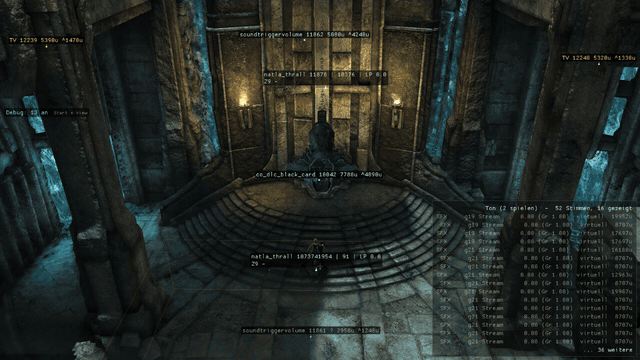
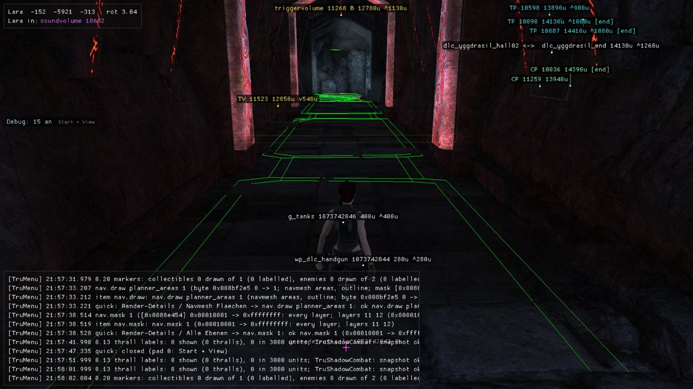
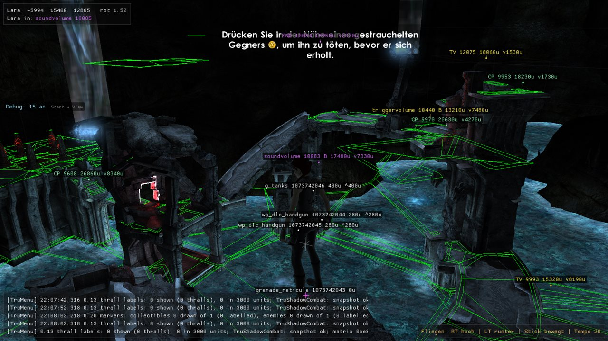
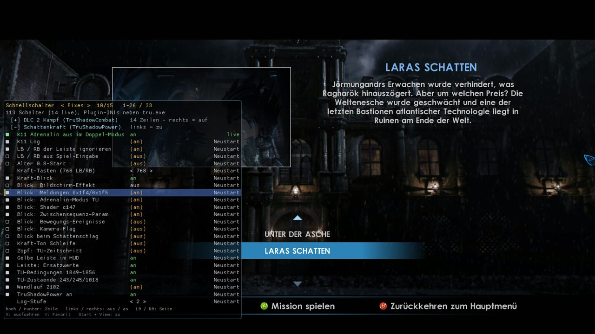
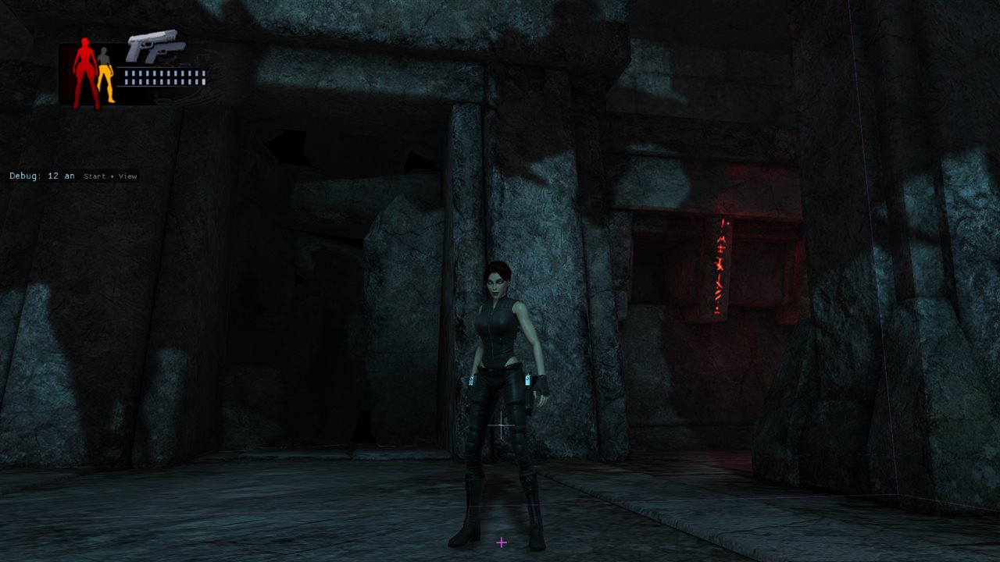
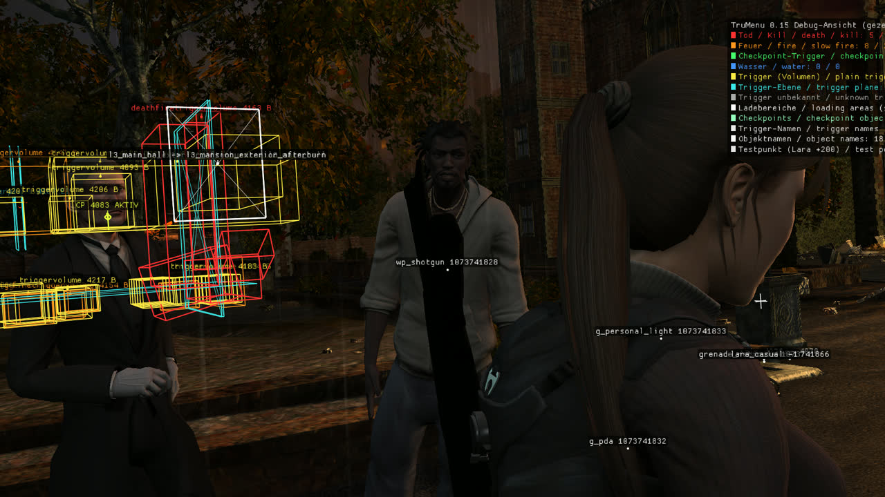
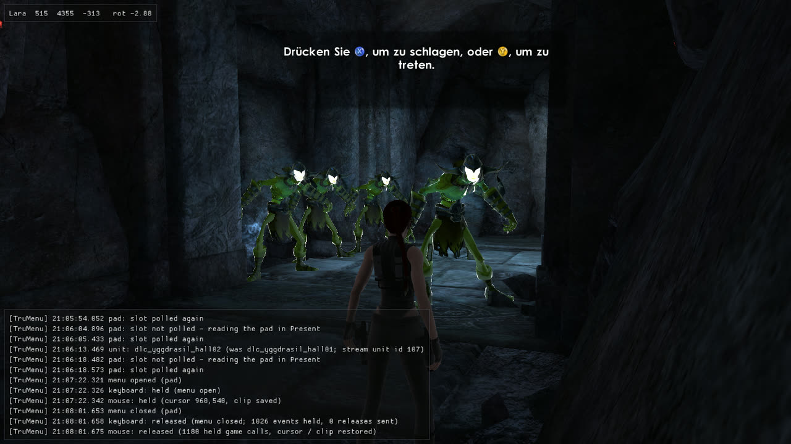

# Development log

Snapshots from development builds - what the test tools show along the way, newest first. Nothing here is needed to
install or play; the [README](../README.md) and [INSTALL](INSTALL.md) cover that. Images are development builds (debug
overlays, log lines, sometimes substitute shaders), scaled down to 1280 px. The README shows the current state; older
pictures move here.

## 2026-11-08 - the flicker at the throne, with the cutscene held

*Development build, test overlays on (object names, sound list). The end-room cutscene of Lara's Shadow is held with
TruMenu's new cutscene pause (`cine.pause`, 0.22): time, actors and camera stand still, the world runs on - and the
throne still switches between lit and dark, the figures on the stairs with it. So the flicker is not the cutscene's
timeline but something that exists only while the cutscene runs (in normal play the throne does not flicker). Ruled
out so far: a doubled pod model (`dlc2_uo_natlapod`, an exact runtime copy on top of the placed one - removed live,
the flicker stayed) and the black fade card. The walls with baked light stay steady, so the next suspect is the
dynamic light per model (the cutscene brings its own lights around the figures). Open in TODO; recorded 4 s of the
game window, 12 frames per second.*

## 2026-11-08 - the README's former status block (state 2026-11-05, updated 2026-11-08)

On 2026-11-08 the README got a short status table instead; the plugin details moved to [PLUGINS.md](PLUGINS.md). The
former text is kept here as it was (links adjusted to this folder).

The former introduction: *For Lara's Shadow this fork takes its own route: its own conversion of the DLC 2 data, and
the Doppelgänger's shadow power - which came to the Xbox with a game update, not with the DLC files - rebuilt as small
add-ons for the PC game, together with tools that repair converted data and help testing in the game.*

**Current state (2026-11-05, tested on one PC, not a release)**

- DLC 1 (B138): fixes found while testing - the "display driver" box on entering the DLC (shader constants), the
  grapple ring's look, cinematic speech in all five languages. Rebuilt reproducibly by the pipeline step `Repair`.
  DLC 1 starts correctly after playing DLC 2 in the same session (played).
- DLC 2 (*Lara's Shadow*), played in our test builds through the Yggdrasil halls: intro, loading-screen title and
  hint boxes like on the Xbox; the Doppelgänger's original look (title-update shaders translated); the shadow power
  (slow motion, meter and its HUD); the wall run on the rock veins with its camera; the shadow combat moves; the
  waterfall. The crash when thralls were unloaded is fixed, dying around the wall run no longer crashes. The end area
  was reached by a level change, not yet played through in one go. Test evening 8 Nov 2026: the end cutscene is
  visible (it was black), the ceremony room no longer crashes while the goo cannonballs fly, the end-room floor is
  textured and the goo particles look right (soft drips instead of square dots).
- Both DLC: the data fixes found through crash dumps are pipeline steps (WINDOWS_REBUILD.md findings 44-48); our
  `generalbank` (the title update's loading-screen and hint-box scripts ported to PC) is built by the pipeline step
  `Generalbank`.
- Testing: test runs from profiles with automatic log checks (`Invoke-TruTestRun.ps1`, `tests/profiles/`), an
  in-game controller menu with a radial menu and a guided test flow (`TruMenu`), a local link for scripted checks
  (`TruLink`) and a log-only trace of sounds, state changes, spawns and level loads (`TruTrace`).

The README picture's former caption: *Current development build (7 Nov 2026): the start of Lara's Shadow with the test
menu's quick bar, page "Kostueme" (TruMenu 0.21.6) - every outfit of the game's cycle list, here the DLC costume f
"Casual Explorer".*

**Still missing (short list)**

- DLC 2, **where manual play stops now (8 Nov 2026):** jumping from a ledge to a rock vein - Lara reaches the vein's
  attach state, then turns back to the ledge within half a second (state-chart log taken, analysis pending). Getting
  further needs the test menu's teleports.
- DLC 2: the shadow finisher never starts (its target list stays empty); thralls now take damage and die with the
  translated damage switch (`TruShadowCombat` `[Damage] Translate`, live test 07.11.), a full playthrough of the first
  thrall fight is being tested; a moaning sound loops; Lara's ponytail stretches during the slow motion (the title
  update's cloth time step is translated behind a switch, off by default); some title-update shaders are still drawn
  with substitutes; the achievement fix is untested in game.
- DLC 1: a crash while loading the dungeon in our current test builds (under investigation).
- Costume packs: converted and checked offline (pipeline step `Costumes`), not played yet.
- What we check after every change: [Regression-DLC2.md](Regression-DLC2.md) (DLC 2) and
  [Regression-DLC1.md](Regression-DLC1.md).

## 2026-11-07 - the enemy navmesh, drawn by the game itself

The PC `tru.exe` still contains the complete debug drawing of the pathfinding middleware (NavPower). The switches are
plain bytes in the executable and are off in the retail build. TruMenu 0.21 turns them on from the quick bar (page
*Render-Details*, group *Navmesh*); this evening they were seen on screen for the first time.

*Lara's Shadow, corridor from the second Yggdrasil hall to the end area. Green: the outlines of the navmesh areas -
the floor the thralls may walk on. It only appears with two quick bar rows on: "Navmesh Flaechen" (the game's
`planner_areas` switch) and "Alle Ebenen" (the layer mask; the navgraphs of this unit sit on layers 11 and 12, which
the game leaves out of the mask). Bottom left: TruMenu's log overlay with exactly these two switches.*

*The end area from above (TruMenu's flight mode; key line bottom right). The outlines lie on the tower tops, ledges and
platforms; large areas also reach across the water, and one group floats without floor near the waterfall - possibly
left over from the base-game level this area was built from (not checked yet). The hint at the top is the title
update's finisher hint, which our port shows but does not close yet (the closing messages 34 / 38 are still to be
translated).*

Edge colours, read from the game's draw function (`0x40c3a0`, colours at `0x88e484` ff.): green = plain edge,
red = one side has area flag bit 27, blue / magenta = area flag bit 26 differs / is set, yellow / orange = two 4-bit
area values compared. What the flags mean is not known yet. The installed navgraphs are byte-identical to the Xbox
data, so none of this is a conversion artefact.

## 2026-11-07 - quick bar pages: plugin switches, costumes, a borrowed outfit

*TruMenu 0.21.5, page "Fixes": all 113 INI switches of our plugins in one place, one group open at a time, "live" or
"Neustart" (takes effect after a restart) per row. Here the shadow power group, over the DLC 2 mission menu.*

*Costume test in TruMenu 0.21.6 at the start of Lara's Shadow: switched back from costume f to `doppelganger_casual`, the
outfit that loads the DLC 2 player extension with it - the game then treats Lara as the doppelganger again and shows
the shadow meter (top left, red and yellow).*

## 2026-11-06 - debug view at Croft Manor

*The test menu's debug view (TruMenu 0.15) in the base game, on the forecourt at Croft Manor's entrance during the
end-of-chapter cutscene. Trigger volumes by kind (red: fire that kills, yellow: plain, cyan: planes), the loading area
between the main hall and the exterior, the active checkpoint and object names. The main hall's triggers hang beside
the cutscene's facade set - the walkable interior is not behind it.*

## 2026-11-02 - thralls in the second Yggdrasil hall

*DLC 2 in the second Yggdrasil hall with the test menu's log overlay. The thralls still use substitute shaders here
(translated since).*
