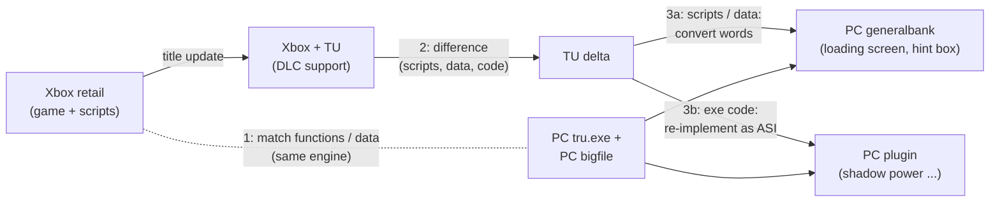

# Plugins (ASI) of branch `windows`

The fork's plugins are small DLLs (`*.asi`) for the PC `tru.exe` (Steam, Tomb Raider: Underworld 1.1). The ASI loader
(Ultimate ASI Loader as the `binkw32.dll` proxy; ModLoader is itself one of the plugins it loads) loads every `*.asi`
next to `tru.exe`, before the game's WinMain ([ENGINE.md](ENGINE.md) section 3 "Start-up order"). Each plugin has its own
folder in [`src/asi/`](../src/asi/), its own README, an INI file and a log file next to `tru.exe`. Install and remove
them with `scripts/windows/Set-Tru<Name>.ps1` ([scripts/windows/README.md](../scripts/windows/README.md)). Every
plugin checks the bytes of `tru.exe` before it patches anything; on a mismatch that part stays off and the log says
why.

"Played" = tested in game on one PC. "Offline" = only static checks (byte checks, builds, checker scripts), not yet
seen in game. "Partial" = some parts played, newer parts offline. States as of 2026-11-08, taken from the plugin
READMEs and [CHANGELOG.md](../CHANGELOG.md); the plugin README and the CHANGELOG have the details.

## Overview

| Plugin | Group | Version | State |
|---|---|---|---|
| [TruQoL](#truqol) | base-game comfort | 0.1.2 | partial: frame limiter and thread cap played 2026-11-08; the other keys offline |
| [TruMenu](#trumenu) | base-game comfort (test menu) | 0.22.1 | partial: 0.21.11 and the 0.22 cutscene pause played 2026-11-08; 0.22.1 (sound held, badge, pause at a mark) offline |
| [TruMercLang](#trumerclang) | base-game comfort (fun option) | 0.1 | offline, default off |
| [TruShadowPower](#trushadowpower) | DLC 2 title update | 0.20 | partial: played up to 0.18; 0.19 and 0.20 offline |
| [TruShadowCombat](#trushadowcombat) | DLC 2 title update | 0.6.6 | partial: combat input and damage played; 0.6.6 offline |
| [TruShadowHud](#trushadowhud) | DLC 2 title update | 0.2 | partial: HUD natives played 2026-11-05; 0.2 offline |
| [TruRockVein](#trurockvein) | DLC 2 title update | 0.11 | partial: wall run played; the jump from a ledge to a rock vein turns back |
| [TruDoppelganger](#trudoppelganger) | DLC 2 title update | 0.1 | in the played DLC 2 stack; its README still says "not yet played" |
| [TruDlc2Player](#trudlc2player) | DLC 2 title update | 0.5 | played as part of the DLC 2 stack; `[Costume] TuMapping` off by default |
| [TruLink](#trulink) | developer tool | 0.3 | 0.2 played; 0.3 not yet tried in game |
| [TruTrace](#trutrace) | developer tool | 0.3 | 0.2 played; 0.3 offline |
| [TruDataGuard](#trudataguard) | developer tool | 0.2 | 0.1 played (live runs 50j / 50k); 0.2 not loaded yet |
| [TruGuard](#truguard) | developer tool | - | crash guard by a contributor; see its own folder |

## The shadow power is program code

> [!IMPORTANT]
> **The shadow power is program code of the Xbox title update, not data.** On the Xbox, *Lara's Shadow* lets Lara use
> the Doppelgänger's power (hold LB/RB: the world slows down, a shadow meter drains; attach to and climb "rock
> veins"; shadow combat moves). The PC `tru.exe` never received that exe patch, so no data conversion can bring it
> back. We translate the title-update functions one by one into small plugins (ASI) that use the PC's own engine
> functions with the Xbox's values: `TruShadowPower`, `TruShadowCombat`, `TruShadowHud`, `TruRockVein`,
> `TruDoppelganger`, `TruDlc2Player`. Details:
> [DLC2.md](DLC2.md#doppelgänger--shadow-power-missing-on-pc) and WINDOWS_REBUILD.md finding 43.

What was found and why, for anyone (including the original author) who wants to pick it up:
[WINDOWS_REBUILD.md](WINDOWS_REBUILD.md) finding 43, [DLC2.md](DLC2.md). The engine facts behind every plugin are
collected in [ENGINE.md](ENGINE.md).

## How the Xbox title update is brought to PC

The PC game is close to the Xbox retail game; the DLC need the Xbox **title update** on top. So the missing PC piece
is the title update's *difference*, translated: PC + (TU - Xbox retail) = what the PC needs.

| Step | What | State (2026-11-07) |
|---|---|---|
| 1 | Match Xbox retail and PC: functions, natives, globals (`tools/xbox_pc_funcmap.py`) | 4 155 pairs, ~1 000 confirmed; names from an early 2007 build help |
| 2 | Difference Xbox retail -> Xbox + TU (`tools/xbox_func_diff.py`, Xenia memory images) | done: of 937 "changed" functions 528 are real changes; no main-game fix found; the exe spots of the upstream comparison (K1-K14) named and sorted |
| 3a | Scripts and data of the TU on PC (converted, repaired where PC differs) | loading screen with DLC titles and the hint box done (pipeline step `Generalbank`); the TU's player-list entry for the doppelganger costume and the localised doppelganger lines in progress |
| 3b | Exe code of the TU on PC (shadow power) | slow motion, meter and HUD, power states, the rock-vein wall run and its camera, shadow combat input translated as plugins (played); **thralls take damage and die** (the TU's damage-type switch 0..27, played 07.11.) and shatter without the PC crash (the TU's death switch for lethal impulse hits); cloth time step translated (switch, off); splash damage / adrenaline in doppelganger mode in progress; the shadow finisher's own kill still open |

Since 2026-11-08 [ENGINE.md](ENGINE.md) section 1 also lists the published fixes of the Xbox title update for the main
game and where they were found in the code (static).

## Base-game comfort

### TruQoL

Comfort options for players of the base game: a frame limiter at the game's own frame clock (physics puzzles break
above 60 fps), a field-of-view factor, a camera-shake factor (against motion sickness), a fix for the start-up crash
on PCs with more than 31 CPU threads, and an optional skip of the start-up intro movie. TruMenu stays the debug tool;
TruQoL holds only switches a player wants.

- Version: 0.1.2 (`TruQoL 0.1.2`).
- State: partial. In the live test of 2026-11-08 the frame limiter was active at 60 fps. The thread cap was bisected
  on a 36-thread PC: 8 / 16 / 24 start and load DLC 2, 25 and higher hang at the first load (the default is to become
  8). More worker threads and the 60 fps limit did not change the load time. FOV, shake scale and intro skip are
  offline; the frame limiter's auto-off for DXVK / dxwrapper is not tested with real files.
- INI `TruQoL.ini`: `[FrameLimit] Enabled` / `MaxFps` (60) / `AutoOff`; `[Camera] Fov` (factor, 0 = the game's) /
  `FovCutscenes` / `ShakeScale` (0 = no shakes); `[Startup] ThreadCap` (31 in 0.1.2) / `SkipIntro` (0). Most keys
  can be changed live from TruMenu's page "Fixes"; `Enabled`, `ThreadCap` and `SkipIntro` need a restart.
- Install: `scripts\windows\Set-TruQoL.ps1` (`-Check`, `-Install`, `-Remove`).
- README: [src/asi/TruQoL/README.md](../src/asi/TruQoL/README.md).

### TruMenu

The in-game test and debug menu, used with the Xbox controller and drawn with Dear ImGui. Every entry is also an item
with a stable id that tools run over TruLink. It has a quick bar with pages (for example "Fixes" for the INI switches
of all plugins, "Kostueme", "Rettung" with the soft-lock helpers for players), a radial menu, a command line, level
and checkpoint jumps, test spots and debug drawing (navmesh, triggers, labels).

- Version: 0.22.1 (new: `cine.pause` / `cine.step` / `cine.status` hold a playing cutscene while particles and lights
  run on; 0.22.1 holds the sound with it, shows a badge, and `cine.mark` / `cine.pauseat` stop a cutscene at a
  remembered time - bar page "Tests", group "Zwischensequenz").
- State: 0.21.11 and the 0.22 picture pause played on 2026-11-08; 0.22.1 built and byte-checked, not yet played. Known
  problem: together with the Steam
  overlay it can crash with a stack overflow; turn the overlay off until TruMenu has a re-entry guard
  ([TROUBLESHOOTING.md](TROUBLESHOOTING.md#known-problems-of-the-original-pc-game)).
- INI `TruMenu.ini` (all keys come from one table in the source): `[Menu] ToggleButtons` (L3 + R3) / `ToggleKey` /
  `BlockGameInput` / `PauseGame`; `[Radial]`; `[Cmd]`; `[Log]`; `[Test]`. Data files: `TruMenu.switches.txt` (the
  page "Fixes"), `TruMenu.radial.txt`, `TruMenu.tour.txt`.
- Install: `scripts\windows\Set-TruMenu.ps1`.
- README: [src/asi/TruMenu/README.md](../src/asi/TruMenu/README.md).

### TruMercLang

A fun option: the mercenaries on the ship levels shout their lines in another language, while Lara, the story, the
subtitles and the menus keep the game language. No audio is shipped; the PC game already holds every merc line in all
five languages.

- Version: 0.1.
- State: offline (byte checks against the installed `tru.exe`), default off.
- INI `TruMercLang.ini` `[MercLang]`: `Enabled` (0), `Language` (`en` `fr` `de` `it` `es`), `PathFilter`,
  `LiveReload`.
- Install: `scripts\windows\Set-TruMercLang.ps1`.
- README: [src/asi/TruMercLang/README.md](../src/asi/TruMercLang/README.md).

### Set-TruDisplay.ps1 and the known problems (not plugins)

- `scripts\windows\Set-TruDisplay.ps1`: depth of field (in the PC game, but off by default), aspect ratio for 21:9 /
  32:9, the stutter fix of the community guides - with a registry backup and a `-Check` dry run. Not yet tried in game.
- Known problems of the original PC game and their workarounds:
  [TROUBLESHOOTING.md](TROUBLESHOOTING.md#known-problems-of-the-original-pc-game).

## DLC 2 title update

### TruShadowPower

The slow motion and the meter of the DLC 2 shadow power: while LB or RB is held the world slows down and the meter
(the yellow silhouette in the HUD) drains; it refills over time. Since 0.3 the meter is a function-by-function
translation of the title-update code that reads its rates from the same data the Xbox reads.

- Version: 0.20.
- State: partial. Played up to 0.18 (0.18, no retail adrenaline in doppelganger mode, played 2026-11-07); 0.19
  (TruMenu's pad block) and 0.20 (`[Look] CameraFlag` default 1 as the title update) built, not played.
- INI `TruShadowPower.ini`: `[ShadowPower] Enabled` / `Buttons` (768 = LB or RB) / `MenuInput`; `[Meter] HudBar` /
  `Fallback`; `[Look] AdrenalineMode` / `CameraFlag`; `[Cloth] TuTimeStep` (0: the title update's player cloth time
  step, against the stretched ponytail in slow motion); `[Adrenaline] Translate`.
- Install: `scripts\windows\Set-TruShadowPower.ps1`.
- README: [src/asi/TruShadowPower/README.md](../src/asi/TruShadowPower/README.md).

### TruShadowCombat

The DLC 2 combat of the title update: the larger target list, the new combat conditions and states, the shadow
strike, the title update's damage-type switch, lethal impulses, splash damage, the thrall's companion and the
regenerate / death rules of the thralls.

- Version: 0.6.6.
- State: partial. Shadow combat input played; thralls take damage and die with `[Damage] Translate` (live test
  2026-11-07); 0.6.4 ran in the live test of 2026-11-07. 0.6.6 (T5, Vaulted chain and clock) offline. Open: the shadow
  finisher never starts (its target list stays empty).
- INI `TruShadowCombat.ini`: `[ShadowCombat] Enabled` / `LogLevel`; `[TargetList] Enabled`; `[Strike] Translate`
  (0); `[States] Translate1013` (0, finisher); `[Damage] Translate` (1); `[Chunk] Translate`; `[Splash] Translate`;
  `[Companion] Translate`; `[Death] TranslateT5` / `TranslateVaulted` / `TranslateVaultedClock` and the other
  `[Death]` switches; `[Diag]` log-only hooks. Most switches are read again at run time.
- Install: `scripts\windows\Set-TruShadowCombat.ps1`.
- README: [src/asi/TruShadowCombat/README.md](../src/asi/TruShadowCombat/README.md).

### TruShadowHud

The HUD natives of the DLC 2 shadow meter that the title update added (`larabase` f70-f73, `dlc2data` f0 / f1). The
title update's HUD script colours the meter with them: red while the power cannot start, pulsing when the shadow
strike is ready. It needs the generalbank with the title update's HUD script; that generalbank must not be used
without this plugin.

- Version: 0.2.
- State: partial. The HUD natives were played on 2026-11-05 (CHANGELOG); 0.2 (`dlc2data` f1) built 2026-11-07, not
  played. Its README still marks 0.1 as not played.
- INI `TruShadowHud.ini` `[ShadowHud]`: `Enabled`, `LaraNatives`, `Dlc2Data`, `MeterApi`, `TranslateDlc2F1`.
- Install: `scripts\windows\Set-TruShadowHud.ps1`.
- README: [src/asi/TruShadowHud/README.md](../src/asi/TruShadowHud/README.md).

### TruRockVein

The rock veins: the two markup conditions 607 / 608 of the title update, so that LB/RB + A starts the attach move,
the wall run with its geometry and a chart log of Lara's state machine. Since 0.10 also the title update's
SweepAndPrune limits of the markup manager, since 0.11 the title update's ledge-corner nudge.

- Version: 0.11.
- State: partial. The wall run on the rock veins was played up to the first Yggdrasil hall. 0.11 was installed in the
  live test of 2026-11-08. There manual play stops at the jump from a ledge to a rock vein: the chart log shows the
  vein's attach state reached, then Lara turns back to the old ledge within 0.2-0.6 s (with and without the shadow
  power); analysis pending.
- INI `TruRockVein.ini`: `[RockVein] Enabled` / `LogUnhandled` / `Type607` (23) / `Type608` (22);
  `[SweepAndPrune] Translate` (1, restart); `[LedgeCorner] Translate` (1, restart).
- Install: `scripts\windows\Set-TruRockVein.ps1`.
- README: [src/asi/TruRockVein/README.md](../src/asi/TruRockVein/README.md).

### TruDoppelganger

The state-machine ids the title update added for the DLC 2 player: 13 conditions, 9 activities and 8 states. The
plugin copies the three PC tables, appends these records and points the builder at the copies.

- Version: 0.1.
- State: part of the DLC 2 plugin stack that was played up to the first Yggdrasil hall ([DLC2.md](DLC2.md)); the
  regression runs check its log line `title-update ids registered`. Its own README still says "not yet played".
- INI `TruDoppelganger.ini` `[Doppelganger]`: `Enabled`, `AddConditions`, `AddActivities`, `AddStates`.
- Install: `scripts\windows\Set-TruDoppelganger.ps1`.
- README: [src/asi/TruDoppelganger/README.md](../src/asi/TruDoppelganger/README.md).

### TruDlc2Player

The doppelganger as the player object, as the title update does it: the type record `doppelganger_casual` with
DoppelgangerInit, the costume name substitution, the doppelganger flag and its reset, so that DLC 1 after DLC 2 is
normal Lara again.

- Version: 0.5.
- State: played as part of the DLC 2 stack (the regression runs check `DoppelgangerInit finished`). 0.5's title-update
  costume mapping in saves and spawns is behind `[Costume] TuMapping`, default 0.
- INI `TruDlc2Player.ini` `[Dlc2Player]`: `Enabled`, `Costume`, `TypeRecord`, `FlagReset`, `CostumeReset`,
  `TrackerFlag`; `[Costume] TuMapping` (0).
- Install: `scripts\windows\Set-TruDlc2Player.ps1`.
- README: [src/asi/TruDlc2Player/README.md](../src/asi/TruDlc2Player/README.md).

## Developer tools

### TruLink

A live read / write channel into the running game for tests: a small TCP server on 127.0.0.1 with a line-based text
protocol, driven from PowerShell (`scripts\windows\Invoke-TruLink.ps1`). It can list and run every TruMenu item. 0.3
adds a memory search, polled watches and struct snapshots.

- Version: 0.3.
- State: 0.2 played; 0.3 built and checked with `dumpbin` only, not yet tried in game (README).
- INI `TruLink.ini` `[TruLink]`: `Enabled`, `Port` (9265), `AllowForce`, `GameThreadTimeoutMs`, `Scan*`.
- Install: `scripts\windows\Set-TruLink.ps1`.
- README: [src/asi/TruLink/README.md](../src/asi/TruLink/README.md).

### TruTrace

A log-only plugin: every hook writes log lines and then runs the original code unchanged. It traces sounds, teleports,
state-chart changes, spawns, level loads, portals, saves and progress objects, to find where a fix has to go.

- Version: 0.3.
- State: 0.2 played (2026-11-05); 0.3 built 2026-11-05, offline self test and byte checks, not played.
- INI `TruTrace.ini` `[Trace]`: one switch per category (`Sound`, `Teleport`, `Chart`, `Spawn`, `Level`, `Portal`,
  `Save`, `Progress`, ...), rate limits `MaxLinesPerSecond` / `MaxLinesPerCategory`.
- Install: `scripts\windows\Set-TruTrace.ps1`.
- README: [src/asi/TruTrace/README.md](../src/asi/TruTrace/README.md).

### TruDataGuard

A safety net and detector for converter data faults: an invalid section id becomes a logged "not found" instead of a
crash, at known lookup points only, using the engine's own not-found path. The real fix stays in the converter.

- Version: 0.2.
- State: 0.1 played (live runs 50j / 50k); 0.2 (no false positives in the unload callback) built, not loaded yet.
- INI `TruDataGuard.ini` `[DataGuard]`: `Enabled`, `LogLevel`, `SectionLookup`, `SectionExists`, `UncheckedCallers`,
  `LogFirst`, `LogUnit`.
- Install: `scripts\windows\Set-TruDataGuard.ps1`.
- README: [src/asi/TruDataGuard/README.md](../src/asi/TruDataGuard/README.md).

### TruGuard

TruGuard (crash guard by a contributor; see its own folder).
